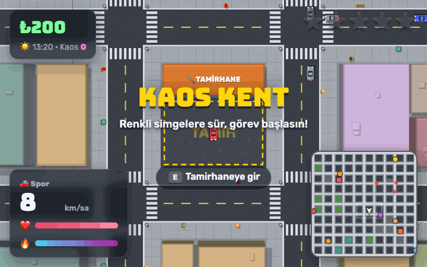

**English** · [Türkçe](README.tr.md)

# Kaos Kent (Chaos City)

A browser game where you drive around a top-down city, take on missions and cause chaos.
Plain HTML + CSS + JavaScript (canvas). No installation, libraries or build step.

🎮 **Play now:** https://muhammedozkul.github.io/kaos-kent/

<p align="center"></p>

## Running it

```bash
python3 -m http.server 8770 --directory ~/Projeler/kaos-kent
```

Then open http://localhost:8770 in your browser. (Double-clicking `index.html` also works.)

## Controls

| Key | Action |
| --- | --- |
| W A S D / arrows | drive |
| Space | handbrake (drift) |
| Shift | nitro (sprint while on foot) |
| F | get out / get into a nearby car (steal it) |
| E | repair shop (while inside the orange area) |
| H | horn |
| G | abandon mission |
| P / Esc | pause |
| M | sound on/off |

## What's in the game

- **City:** a 102×102 tile map (10×10 blocks); roads, sidewalks, fake-3D buildings (rooftops shift with the camera), parks, lakes, parking lots, 2 repair shops, a police station, a hospital and a fire station.
- **Pedestrians:** 130 people walk the sidewalks; they scatter from speeding cars, horns and explosions. If hit, they fall over cartoon-style and get back up.
- **Getting in and out of cars:** press F to get out, walk (Shift to run), get into another car. Stealing a civilian car makes the driver flee (★), stealing a police car is ★★. Each model has its own speed, weight and durability (sports car, sedan, hatchback, pickup, police, ambulance, fire truck).
- **Weather:** clear / rain / storm change on their own. In rain, tire grip and braking drop, puddles appear and pedestrians open umbrellas; in storms, lightning strikes.
- **Traffic:** 70 civilian cars drive in their own lanes from junction to junction and slow down to avoid hitting the car in front.
- **Police and stars:** the more chaos you cause, the more "heat" builds up, becoming 1–5 stars. If the police can see you, they drive at you; if not, they search junction by junction. Stay out of sight for 4 seconds and your stars drop. If the police reach you while you're stopped, you're busted.
- **Missions:** 🍕 delivery, 🚕 taxi, 🏁 street race, 🚨 big escape, 💥 chaos hour, 📦 delivery chain (3 deliveries, getting faster). Get into the ambulance at the hospital for a 🚑 ambulance mission (pick up the patient, rush them to the hospital); get into the truck at the fire station for a 🚒 fire mission (put out two fires).
- **Repair shop:** repairs, engine / armor / nitro upgrades, paint.
- **Day and night:** one day lasts 5 minutes; at night headlights, street lamps, window lights and sirens light up.
- **Effects:** tire marks (permanent), sparks, smoke, explosions, hydrant water, nitro flames. Sounds are generated with Web Audio.
- **Saving:** money, upgrades and stats are stored in the browser (`localStorage`).

## Files

| File | What it does |
| --- | --- |
| `index.html` | Page skeleton, HUD, start/pause/repair shop screens |
| `style.css` | Interface look |
| `js/yardimci.js` | Math helpers, keyboard, sounds |
| `js/harita.js` | City generation, chunked ground drawing, road/junction queries |
| `js/araba.js` | Car models, physics (forward/lateral speed, drift, wet roads) and drawing |
| `js/efektler.js` | Particles (including flames, water, rain rings) and floating text |
| `js/yaya.js` | Pedestrians, the player on foot, sidewalk loop |
| `js/hava.js` | Weather, rain drawing, puddles |
| `js/trafik.js` | Civilian and police AI |
| `js/gorevler.js` | Mission types and mission panel |
| `js/hud.js` | Dashboard, minimap, repair shop |
| `js/oyun.js` | Main loop, collisions, wanted system, camera, lighting |
